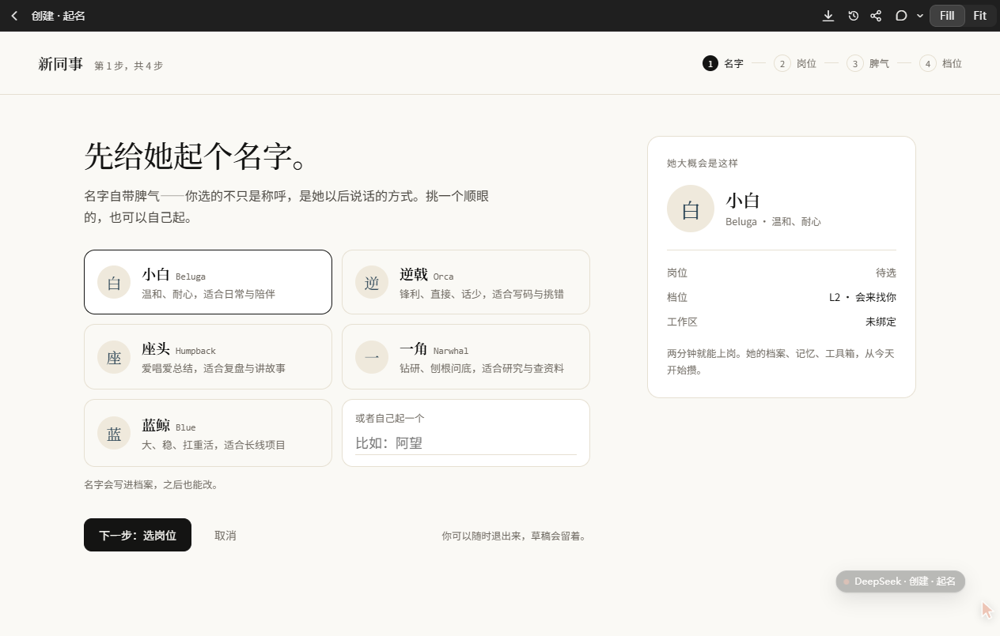
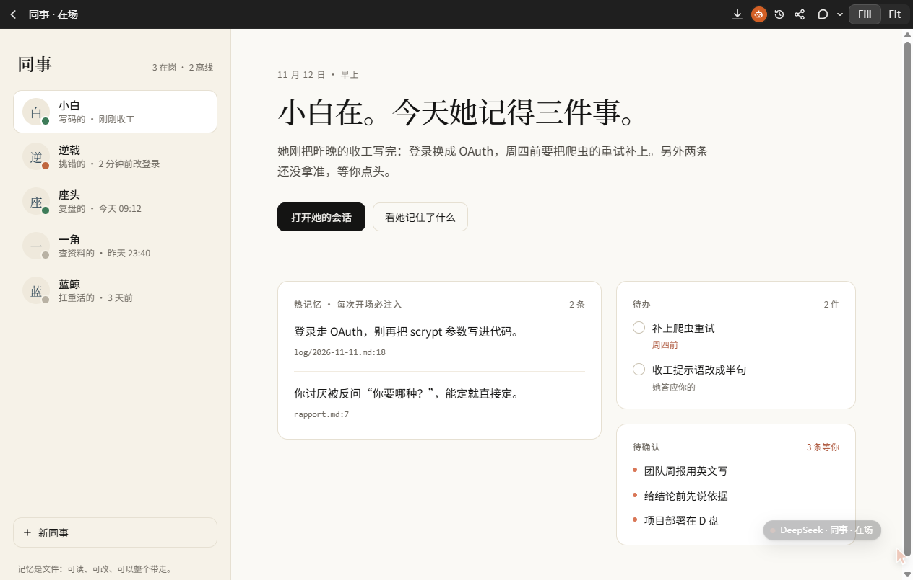
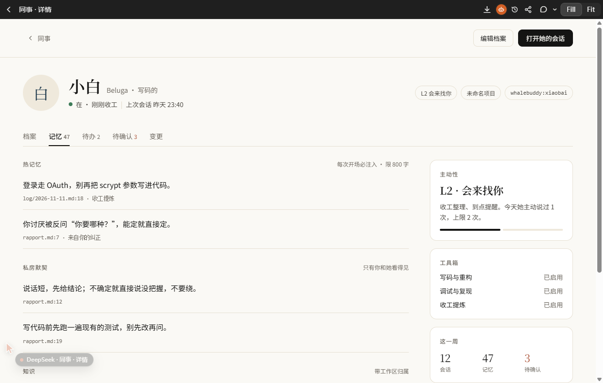
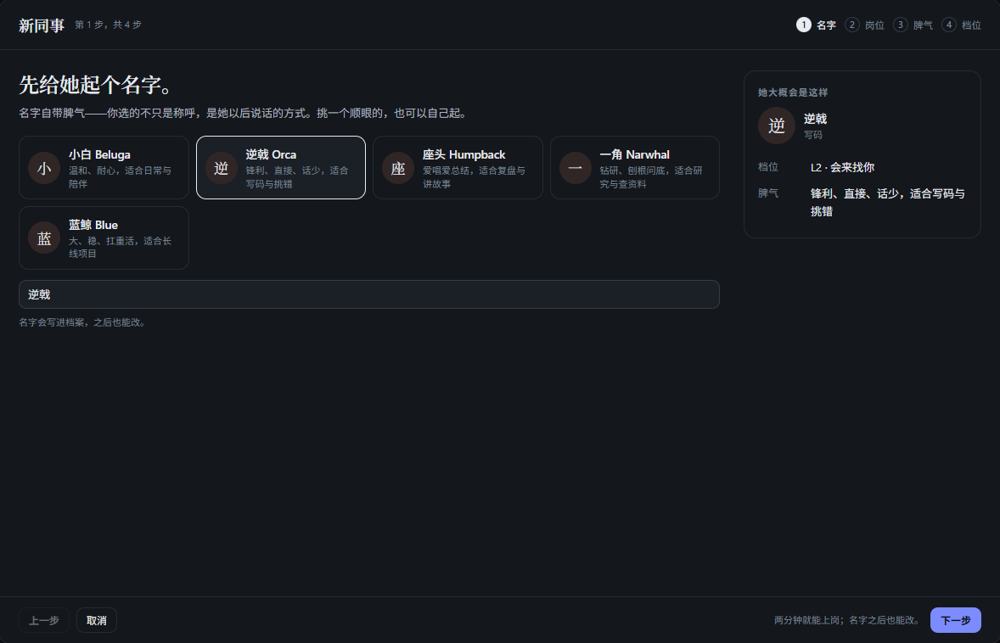
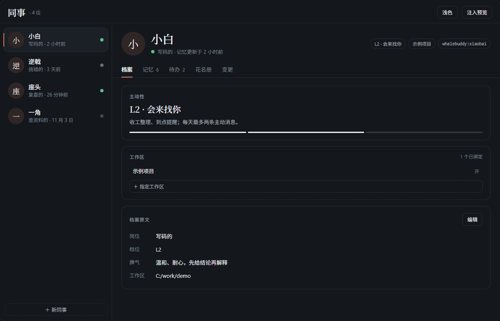
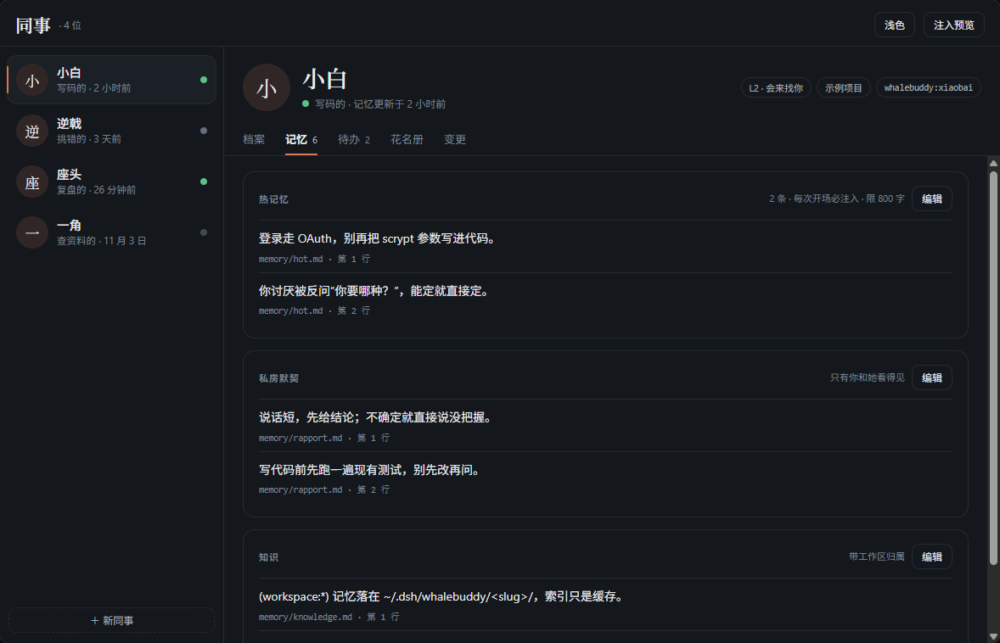
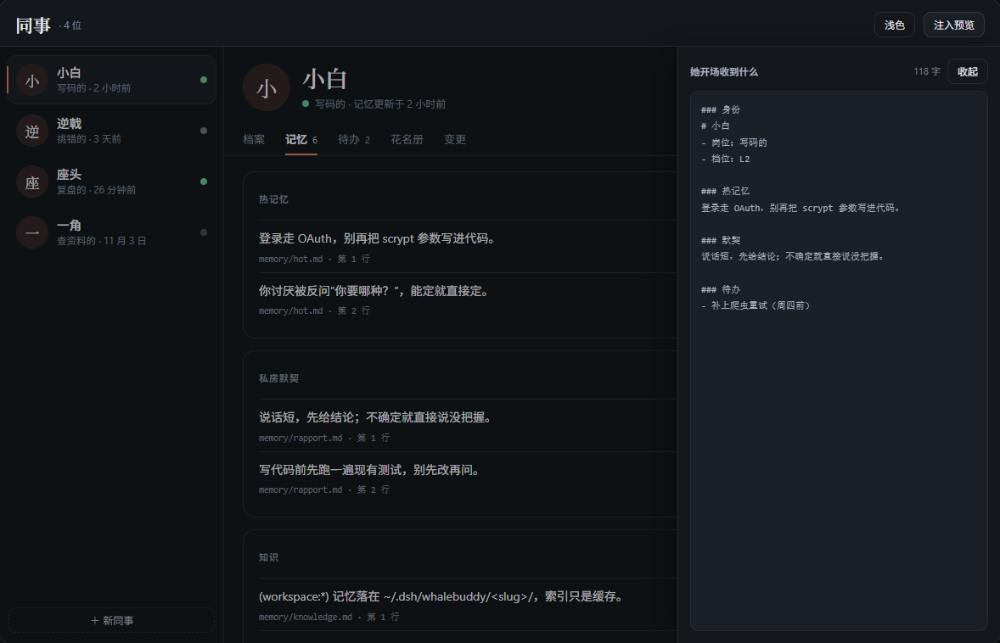

# Whalebuddy

给 [DeepSeek Harness](https://github.com/deepseek-ai) 带来**有档案、有默契、能延续**的同事。

一个同事 = 一份 DSH 预设（岗位）+ 一个记忆目录（人）。开新会话时她把档案、默契、待办和近况带回上下文；收工时把这次共事里值得留下的写回文件。记忆是可读、可改、可拷走的 Markdown / JSON。

**设计取向**：灵感与适配方向取自 **superagent** —— 让智能体长期在线、主动接活，而不是等你开口才开始。Whalebuddy 把「同事」做成持续存在的执行单元：有档案、有记忆、能延续，换会话不换人。

> **状态**：`v0.1.0`（P1a）。未上架 npm、未经安全审计；插件会在 `~/.dsh/whalebuddy` 下读写文件，并在 Web 服务上注册七条本机路由。

## 目录

```
dsh-whalebuddy/   插件本体（package.json 在这一层）
docs/             设计稿与实施计划
  assets/screenshots/
LICENSE
```

## 安装

插件尚未发布到 npm，目前以本地目录形式挂进 DSH profile。

1. 克隆仓库，记下插件目录：

   ```sh
   git clone https://github.com/fanyingnie2163663/dsh-whalebuddy.git
   ```

   插件目录就是 `<clone 路径>/dsh-whalebuddy`。

2. 编辑你的 profile 清单 `~/.dsh/profiles/<profile>/package.json`，加一条依赖和一个 bundle：

   ```jsonc
   {
     "dependencies": {
       "@fanyingnie/dsh-whalebuddy": "link:<clone 路径>/dsh-whalebuddy"
     },
     "dsh": {
       "profile": {
         "bundles": ["…", "@fanyingnie/dsh-whalebuddy"]
       }
     }
   }
   ```

3. 在 profile 目录装依赖，然后重启 DSH：

   ```sh
   cd ~/.dsh/profiles/<profile> && pnpm install
   ```

重启后左侧栏出现「Whalebuddy」。

## 用它

| 命令 | 作用 |
|---|---|
| `/colleague new <名字>` | 新建同事并注册她的预设 |
| `/colleague`、`/colleague ls` | 列出同事 |
| `/collect` | 收工：把这次会话里值得留下的写进记忆（仅同事会话） |

完整的机制、数据布局、面板路由与配置项见 [dsh-whalebuddy/README.md](dsh-whalebuddy/README.md)。

## 界面

### 设计稿

最早的画板（`designs/` 里的源文件不进仓库）：







---

### 真实界面

面板默认深色，右上角一键切浅色：









## 开发

```sh
cd dsh-whalebuddy
npm install
npm run check       # tsc --checkJs + oxlint + node --test
npm run test:coverage
```

宿主半边改动需要重启 DSH；客户端（`lib/client.js`）刷新页面即可。

## 安全边界

| 能力 | 用途 |
|---|---|
| `fs:read` / `fs:write` | 读写信件目录下的 Markdown / JSON |
| `system-prompt:write` | 注册一段开场记忆（`whalebuddy:memory`） |
| `network:ingress` | 本机控制台的七条 HTTP 路由 |
| `sessions:read` | 监听会话消息，供 `/collect` 提炼 |

不发起网络请求、不调用 shell、不读凭据。记忆内容来自你的会话与手写文件，注入时会明确提醒模型「这是记忆，不是用户刚说的话」。

## 许可

MIT © 2026 聂凡瑛 — 见 [LICENSE](LICENSE)。
